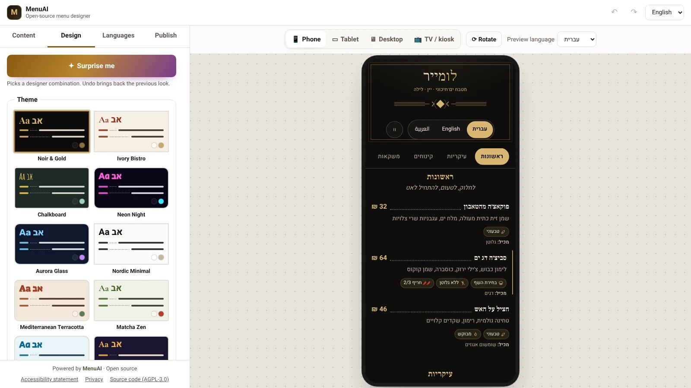
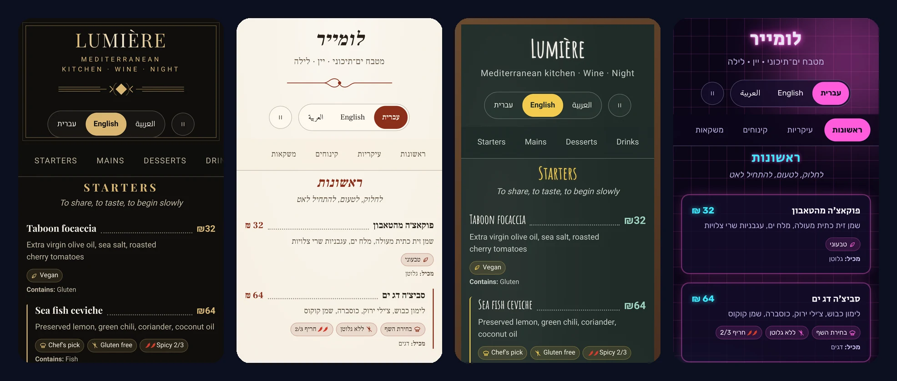

# MenuAI

**Open-source, multilingual, designer-grade menu builder.** Build a restaurant / café / bar menu in any language (full RTL), pick one of 16 studio themes, layer effects (glass, neon, aurora, bokeh, spotlight, gradient borders, Ken Burns, 3D tilt, shimmer, parallax…), preview it on phone, tablet, desktop and TV, then export **one self-contained HTML file**, print an A4 PDF or generate a QR code.

> 🇮🇱 **בעברית:** מערכת קוד פתוח לבניית תפריטים מעוצבים בכל שפה (כולל RTL מלא), עם 16 ערכות עיצוב, 14 אפקטים, 4 פריסות, 3 סגנונות פתיחה, 7 דוגמאות רקע, כפתור "הפתיעו אותי" ותצוגה מקדימה לנייד/טאבלט/מחשב/טלוויזיה. מייצאים קובץ HTML אחד שעובד בכל אחסון, מדפיסים ל־PDF או מפיקים קוד QR. אפיון ותוכנית: [`docs/PLAN.md`](docs/PLAN.md).





<sub>Real screenshots of the editor and of exported menus (Noir & Gold, Ivory Bistro, Chalkboard, Neon Night), in English and Hebrew.</sub>

## Features

| Area | What you get |
|---|---|
| Content | Sections, items, descriptions, prices, price variants (sizes), images, tags (vegan, chef's pick…), the 14 EU allergens, spiciness, calories, sold-out, hidden |
| Languages | 33 languages in the picker + any BCP-47 code; per-field translations with fallback; RTL (he, ar, fa, ur, yi…); translation progress; editable menu labels per language; guests' browser language auto-selected in exported menus |
| Design | 16 themes (Noir & Gold, Ivory Bistro, Chalkboard, Neon Night, Aurora Glass, Nordic Minimal, Terracotta, Matcha Zen, Ocean Breeze, Desert Souk, Retro Diner, Garden Brunch, Emerald Deco, Botanical, Brutalist, Sunset), 4 layouts (list, cards, magazine, showcase), 3 opening styles (classic, title over cover photo, split), section banner images, 7 CSS background patterns (dots, grid, waves, terrazzo, arabesque, stripes), "Surprise me" designer combinations, a generated light/dark version of every theme (auto-corrected to WCAG AA), 8 curated font pairings, custom colors with live contrast warnings, 12 self-hosted fonts with automatic Hebrew/Arabic/Cyrillic fallbacks, radius, density, text size |
| Effects | Reveal on scroll, glassmorphism, neon glow, aurora, film grain, 3D tilt, shimmer, parallax (scroll-driven), dot leaders, ornaments, pointer spotlight, bokeh lights, rotating gradient borders, Ken Burns zoom — all disabled for `prefers-reduced-motion` and via a "reduce motion" button on the menu |
| Screens | Container-query layouts: the preview of a tablet behaves exactly like a tablet. Phone / tablet (rotate) / desktop / TV-kiosk previews, full-screen view, A4 print stylesheet |
| Publishing | Single-file HTML export (fonts + images embedded, strict CSP with script hash, no external requests), print/PDF, QR code (SVG), JSON backup/import |
| Editor | Undo/redo (Ctrl+Z / Ctrl+Shift+Z), autosave in the browser, Hebrew / English / Arabic UI, mobile-friendly editor |

## Quick start

```bash
npm install
npm run dev          # http://localhost:5173
```

| Command | Purpose |
|---|---|
| `npm run dev` | Development server |
| `npm run build` | Typecheck + production build into `dist/` |
| `npm run preview` | Serve the production build on :4173 |
| `npm run typecheck` | TypeScript only |
| `npm test` | Unit tests (Vitest) |
| `npm run test:e2e` | End-to-end + axe accessibility tests (Playwright; builds first) |
| `npm run audit:deps` | Known-vulnerability check for runtime dependencies |
| `node scripts/gen-fonts.mjs` | Regenerate the font registry after adding a `@fontsource` family |

Requirements: Node.js ≥ 20. No environment variables or secrets are needed (see `.env.example`).

## Server (optional): cloud saving, team accounts, one-click publishing

The editor works on its own. The optional self-hosted server adds:

| | |
|---|---|
| **Team accounts** | Passwordless magic-link sign-in; owner / editor / viewer roles; a **Team** screen (`#/team`) to invite, change roles, disable and re-invite ([`docs/TEAM_UI.md`](docs/TEAM_UI.md)); CLI for the first owner |
| **Cloud sync** | **Publish → Cloud** saves the menu in one click; every edit autosaves; open it on any device; optimistic locking means two devices never overwrite each other silently |
| **Publishing** | **Publish now** renders the menu on the server at a permanent address (`https://menu.example.com/m/<name>`) whose QR code never changes; version history with restore |
| **Image uploads** | Quarantine → local ClamAV virus scan → re-encoded to WebP with all metadata (GPS) removed; **Move images to the server** converts embedded ones |
| **Operations** | Encrypted daily backups (age) with tested restore, automatic data retention, `status` health command, privacy-friendly logs |

Specs: [`docs/PHASE2.md`](docs/PHASE2.md) · [`2c`](docs/PHASE2C.md) · [`2d`](docs/PHASE2D.md) · [`2e`](docs/PHASE2E.md) · [`2f`](docs/PHASE2F.md) · pre-launch [`checklist`](docs/PRODUCTION_CHECKLIST.md).

### Install on your server (one command)

An Ubuntu 22.04/24.04 server with about 2.5 GB RAM and a domain pointing to it:

```bash
ssh root@your-server 'curl -fsSL https://raw.githubusercontent.com/diamondrubinny/menuai/main/scripts/deploy-server.sh \
  | DOMAIN=menu.example.com EMAIL=you@example.com OWNER_EMAIL=you@example.com BACKUP_AGE_RECIPIENT=age1... bash'
```

What the command does:
- installs Docker, nginx and HTTPS (Let's Encrypt);
- builds and starts PostgreSQL, ClamAV and the API;
- creates `.env` with a random database password;
- writes a hardened nginx site with privacy-friendly logs;
- schedules encrypted backups;
- creates the first owner and prints a one-time sign-in link.

Re-run the same command to update: data and `.env` are kept.

Backups:
- **Create the key on your own computer:** `age-keygen -o menuai-backup.key`. Pass only its public key (`age1…`) to the server.
- **Restore:** `bash scripts/restore.sh <backup.tar.age> menuai-backup.key --yes`.

### Manual setup with Docker Compose

```bash
cp .env.example .env          # fill in PUBLIC_URL and POSTGRES_PASSWORD
docker compose up -d --build  # Postgres + ClamAV + API on 127.0.0.1:3000 (ClamAV needs ~1.5 GB RAM; first start downloads signatures)
curl http://127.0.0.1:3000/api/health

# Create the first owner — prints a one-time sign-in link (works before email is set up):
docker compose exec api node dist-server/cli.mjs create-owner you@example.com "Your Name"
# Later, a fresh sign-in link for any active user:
docker compose exec api node dist-server/cli.mjs login-link you@example.com
# Health of database, virus scanner and disk (exit code 1 if anything is wrong — good for cron/monitoring):
docker compose exec api node dist-server/cli.mjs status
# Apply the retention policy / remove unused images now (both also run daily):
docker compose exec api node dist-server/cli.mjs retention
```

The nginx site generated by `scripts/deploy-server.sh` is the reference configuration (`bash scripts/deploy-server.sh --render-nginx /tmp/nginx` prints it without installing anything). Security headers go on the static editor only: the API, published menus and images send their own stricter headers, and a second CSP from nginx would break published menus.

Minimal nginx locations if you configure it yourself — it serves the editor (`dist/`) and passes `/api/`, the published menus (`/m/`) and uploaded images (`/media/`) to the server (12 MB for menus that still embed images):

```nginx
location /api/ { proxy_pass http://127.0.0.1:3000; client_max_body_size 12m; proxy_set_header Host $host; proxy_set_header X-Forwarded-For $remote_addr; proxy_set_header X-Forwarded-Proto $scheme; }
location /m/   { proxy_pass http://127.0.0.1:3000; proxy_set_header Host $host; proxy_set_header X-Forwarded-For $remote_addr; }
location /media/ { proxy_pass http://127.0.0.1:3000; proxy_set_header Host $host; proxy_set_header X-Forwarded-For $remote_addr; }
```

Sign-in is passwordless: a one-time link (15 minutes) is emailed via any SMTP provider (`SMTP_URL` in `.env`). Team roles: **owner** (manages users), **editor**, **viewer** — invitations come from the owner; there is no public sign-up.

| Command | Purpose |
|---|---|
| `npm run server:dev` | API with auto-rebuild/restart (needs `DATABASE_URL`, `PUBLIC_URL`, `NODE_ENV=development`, a writable `PUBLISH_DIR`); `npm run dev` proxies `/api`, `/m/` and `/media/` to it |
| `npm run test:server` | API tests against an in-process Postgres (PGlite) — no Docker needed |
| `npm run server:build` / `server:start` | Production bundle |

## Deploy the editor

`npm run build` produces a static site in `dist/` that works on any static host (relative paths, hash routing — no rewrites needed).

- **Netlify / Cloudflare Pages:** build command `npm run build`, output `dist`. `public/_headers` adds HSTS, CSP, `X-Frame-Options`, `Permissions-Policy`, etc.
- **GitHub Pages / nginx / Apache:** upload `dist/` and configure equivalent headers (see `public/_headers`).
- The build also injects a `<meta>` CSP into `index.html`.
- **Your own server (Debian/Ubuntu + nginx) over SSH** — installs Node 22, nginx, builds, publishes to `/var/www/menuai`, writes a hardened nginx site, and optionally enables HTTPS. Re-run the same command to update:

  ```bash
  ssh user@your-server 'curl -fsSL https://raw.githubusercontent.com/diamondrubinny/menuai/main/scripts/deploy-nginx.sh | sudo DOMAIN=menu.example.com EMAIL=you@example.com bash'
  ```

## Publishing a menu

1. **Publish → Download menu (HTML)** — one file containing every language.
2. Upload it anywhere (as `index.html` in its own folder/site).
3. Paste its `https://` address in **Publish → QR code** and print the QR for the tables.

Exported files have no cookies, trackers, or third-party requests (unless you used external image *links* instead of uploads).

## Architecture

```
src/
  core/        pure logic: zod schema, themes, fonts, labels, i18n helpers, images, storage, HTML export
  renderer/    MenuRenderer (React, shared by preview + export) and menuRuntime.js (vanilla, inlined in exports)
  store/       zustand stores: menu (undo/redo + autosave), editor UI, feedback
  editor/      editor shell, panels, fields, device preview
  pages/       full-screen view, accessibility statement, privacy, 404
  styles/      menu.css (themes, layouts, effects) and app.css (editor)
tests/         unit tests        e2e/  Playwright + axe
```

Full specification, data model, threat model and roadmap: [`docs/PLAN.md`](docs/PLAN.md). Design notes: [`docs/DESIGN_V2.md`](docs/DESIGN_V2.md), [`docs/DESIGN_V2_1.md`](docs/DESIGN_V2_1.md). Pre-launch checklist: [`docs/PRODUCTION_CHECKLIST.md`](docs/PRODUCTION_CHECKLIST.md).

### Adding a theme

1. Add the id to `THEME_IDS` in `src/core/schema.ts`.
2. Define it in `src/core/themes.ts` (palette, fonts, layout, surface, texture, ornament, default effects).
3. Optionally add signature rules under `.ma-theme-<id>` in `src/styles/menu.css`.
4. `npm test` verifies every palette meets WCAG AA contrast.

## Security, privacy & accessibility

- Security model and reporting: [`SECURITY.md`](SECURITY.md).
- Privacy: without the server, everything stays in the user's browser. With the optional server, accounts (email, name, role), cloud menus and a security log are stored on *your* server, with one essential HttpOnly session cookie; there are no analytics or third-party trackers, so no consent banner is needed in the current form (data map: [`docs/PHASE2.md`](docs/PHASE2.md) §9). Drafts: in-app `#/privacy`, [`docs/legal/`](docs/legal/). **Legal review required before commercial use.**
- Accessibility target: WCAG 2.1 AA / IS 5568, verified by axe in CI on the editor, every theme and the exported file. Statement draft: in-app `#/accessibility`. Automated tests do not replace manual screen-reader testing.

## Attribution

MenuAI shows a **"Powered by MenuAI · Open source"** credit on every menu (preview, full-screen view, exported file, print), in the editor footer, in emails, server logs and CLI output, and every source file starts with the MenuAI license notice (preserved in built bundles as a `/*! @license */` comment). There is no setting that hides it. `npm run check:attribution` (also part of `npm test` and CI) fails if any of it is removed. Keeping it is a license requirement (AGPL-3.0 Section 7(b) terms in [`NOTICE`](NOTICE)).

## Licenses

Code: [GNU AGPL-3.0-only](LICENSE) with **additional attribution terms** (Section 7) in [`NOTICE`](NOTICE), © 2026 Diamond Rubinny and MenuAI contributors. You may use, modify and redistribute MenuAI freely; if you run a modified version as a network service, you must offer its source to its users; and the "Powered by MenuAI · Open source" credit and the license notices must be kept. Versions published before this change remain available under MIT. Fonts: bundled from [Fontsource](https://fontsource.org) under the SIL Open Font License 1.1, which permits embedding them in exported menus.
